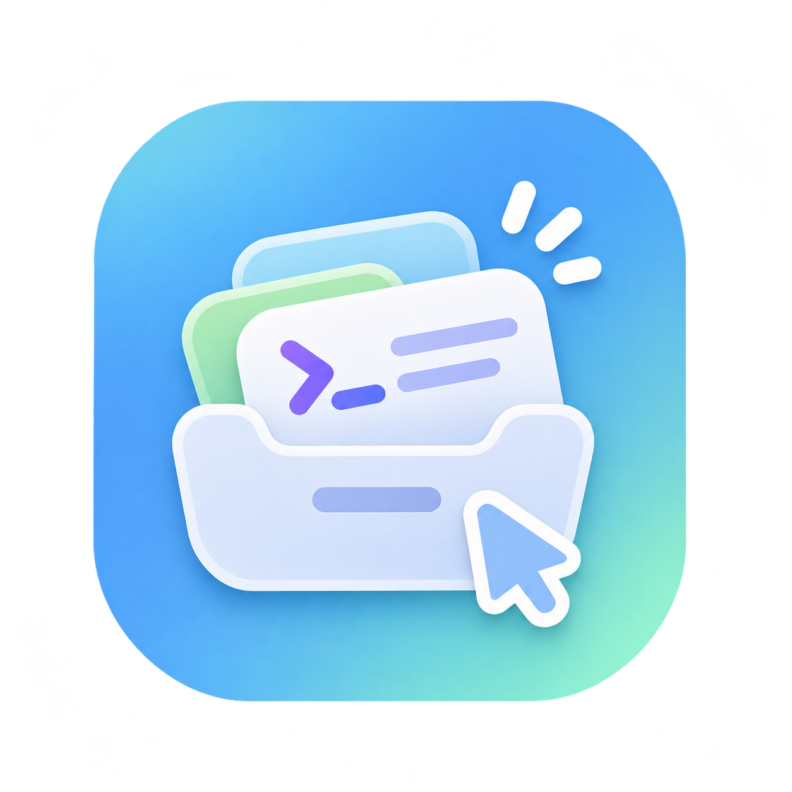
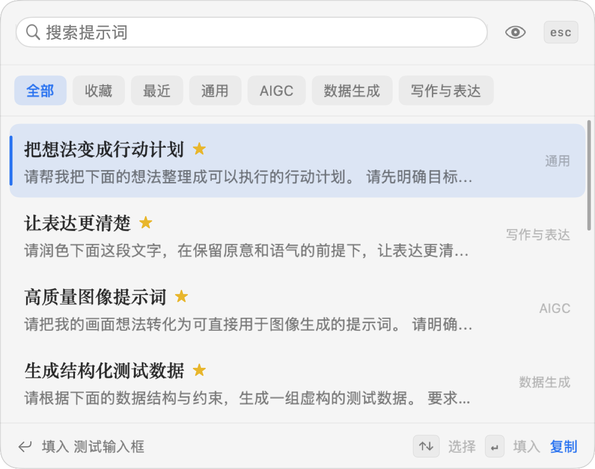

<div align="center">
  
  <h1>PromptShelf · 词屿</h1>
  <p><strong>Your favorite prompts, one shortcut away.</strong></p>
  <p>A local-first prompt library for macOS. Open it from a chat input, find a prompt, and paste it where you left off.</p>
  <p><a href="https://github.com/XXXSECTIONDK-01/PromptShelf/releases"><strong>Download for macOS</strong></a> · <a href="README.zh-CN.md">简体中文</a> · <a href="CHANGELOG.md">Changelog</a></p>
  <p>macOS 14 or later · Apple silicon download · SwiftUI + AppKit</p>
</div>


## From prompt to draft

1. **Save** a reusable prompt in your library. Organize it with categories and favorites.
2. **Find** it by pressing <kbd>⌃</kbd> <kbd>⌥</kbd> <kbd>P</kbd> in a chat input. Search by title or body and navigate with the arrow keys.
3. **Insert** it with Return, or use **Copy** to paste it yourself. PromptShelf leaves the draft ready for you to send.



## Features

- **Reusable prompts.** Search your library, switch categories, and revisit favorites or recently used prompts.
- **One-off edits.** Edit a prompt from the quick panel and insert the edited text while keeping the saved original.
- **Markdown files.** Import and preview Markdown, keep local attachment copies, and drag or paste files into apps that accept them.
- **Local library and backups.** Keep prompts on your Mac, export a portable JSON backup, or optionally import and export through Apple Notes.
- **Native macOS appearance.** Follow the system appearance, use dark mode, and adjust the interface scale and shortcut. [See the dark appearance](docs/media/library-dark.png).

## Install

1. Download the `.dmg` from [Releases](https://github.com/XXXSECTIONDK-01/PromptShelf/releases).
2. Open the image and drag **PromptShelf** into **Applications**.
3. To insert into another app, enable PromptShelf under **System Settings → Privacy & Security → Accessibility**. Copying and browsing the library work without this permission.

The current preview build uses an ad hoc signature and has not been notarized. macOS Gatekeeper may block the download on first launch. Building from source is also supported. Apple Notes uses a separate Automation permission when you choose to connect. File pasting depends on the destination app.

## Build from source

Use an Apple toolchain with the macOS 26 SDK. The app targets macOS 14 and later.

```sh
bash scripts/build-dmg.sh
```

The script writes the app and installer to `dist/`. See [Contributing](CONTRIBUTING.md) for checks and [the Chinese README](README.zh-CN.md) for more detail on data and permissions.

## Feedback

Report reproducible bugs through [Issues](https://github.com/XXXSECTIONDK-01/PromptShelf/issues). Include your app version, macOS version, and steps to reproduce. Use sample prompts when sharing screenshots or files.

Made by [Andy Chen](https://github.com/XXXSECTIONDK-01).

## License

PromptShelf source code is available under the [MIT License](LICENSE).
