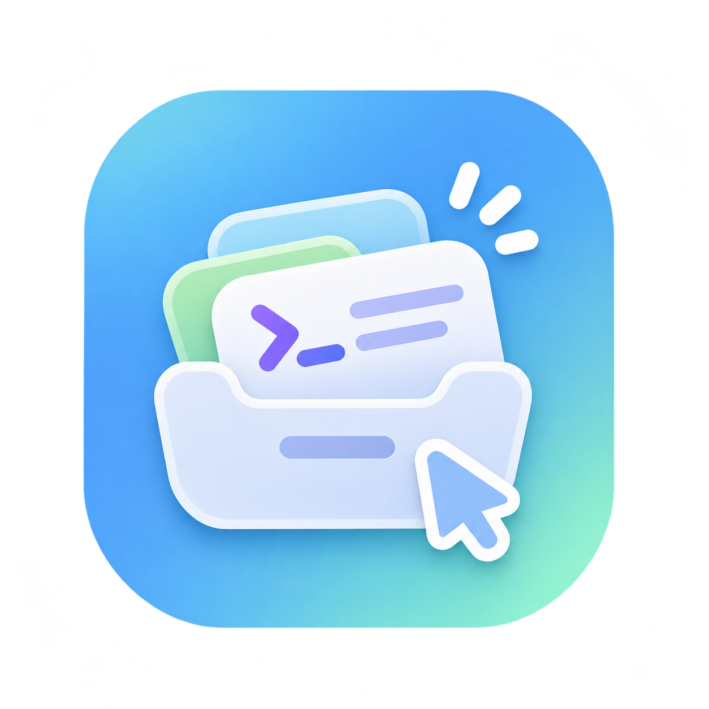
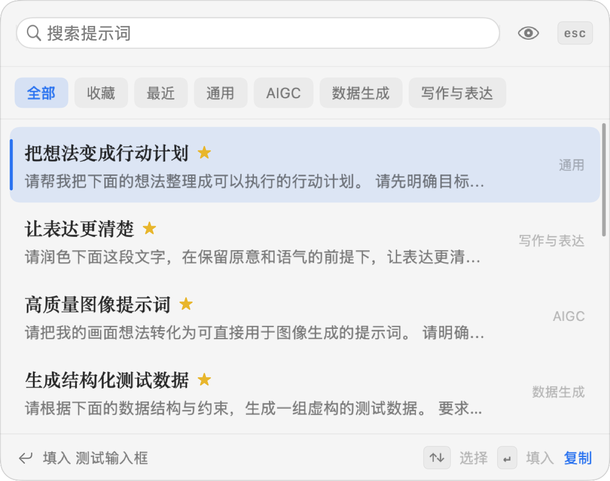

<div align="center">
  
  <h1>词屿 · PromptShelf</h1>
  <p><strong>按一个快捷键，把常用提示词填进聊天框。</strong></p>
  <p>在 Mac 上整理你的提示词。写作、研究或生成图片时，直接从正在使用的输入框唤起词屿。</p>
  <p><a href="https://github.com/XXXSECTIONDK-01/PromptShelf/releases"><strong>下载 macOS 版</strong></a> · <a href="README.md">English</a> · <a href="CHANGELOG.md">更新记录</a></p>
  <p>macOS 14 或更新版本 · 安装包适用于 Apple 芯片 Mac · SwiftUI + AppKit</p>
</div>


## 三步使用

1. **保存提示词。** 添加经常重复使用的内容，用分类与收藏整理。
2. **在输入框唤起。** 按 <kbd>⌃</kbd> <kbd>⌥</kbd> <kbd>P</kbd> 打开快捷面板，搜索标题或正文，方向键选择。
3. **填入草稿。** 按回车填入，也可以点「复制」后手动粘贴。消息由你确认发送。



## 功能

- **提示词库。** 分类、收藏、最近使用和全文搜索，支持自定义快捷键。
- **一次性编辑。** 在快捷面板临时修改提示词，填入本次内容并保留原文。
- **Markdown。** 拖入文档并保存在本机，预览正文，向支持的应用拖放或粘贴文件。
- **本地资料和备份。** 可将完整资料库导出为 JSON，也可按需从 Apple 备忘录导入或导出。
- **原生外观。** 跟随系统浅色或深色，按需要调整整体缩放。可查看[深色界面](docs/media/library-dark.png)。

## 安装

1. 从 [Releases](https://github.com/XXXSECTIONDK-01/PromptShelf/releases) 下载 `.dmg`。
2. 打开磁盘映像，将 **PromptShelf** 拖入 **应用程序**。
3. 如需向其他应用自动填入，在 **系统设置 → 隐私与安全性 → 辅助功能** 中启用词屿。浏览和手动复制无需这项权限。

当前预览安装包采用本地临时签名，尚未经过 Apple 公证，首次打开时可能被 Gatekeeper 拦截。也可以使用自己的 Mac 从源码构建。连接 Apple 备忘录时会请求单独的「自动化」权限。文件输出需要目标应用支持文件粘贴或拖放。

## 数据与权限

提示词、设置和 Markdown 副本存于 `~/Library/Application Support/PromptShelf/`。可在「数据与备份」导出包含正文和附件的 JSON。迁移设备时使用完整备份，也可复制整个资料库目录。

词屿无需注册账号。备忘录仅在你发起操作时连接。使用 iCloud 账户时，由 Apple 备忘录负责跨设备同步。自动填入使用你选中的提示词和记录的输入位置。

## 从源码构建

使用包含 macOS 26 SDK 的 Apple Swift 工具链，应用最低运行目标为 macOS 14。

```sh
bash scripts/build-dmg.sh
```

安装包会生成在 `dist/`。测试和贡献方式见 [CONTRIBUTING.md](CONTRIBUTING.md)。反馈问题请使用 [Issues](https://github.com/XXXSECTIONDK-01/PromptShelf/issues)，并附上词屿版本、macOS 版本和复现步骤。分享截图时使用示例资料。

由 [Andy Chen](https://github.com/XXXSECTIONDK-01) 制作。

## 开源许可

词屿源码采用 [MIT 许可证](LICENSE)。
